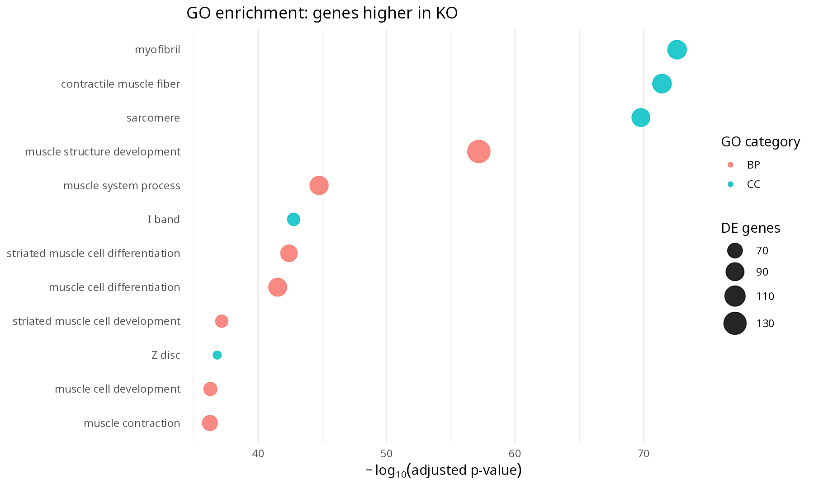
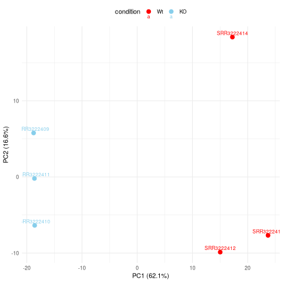
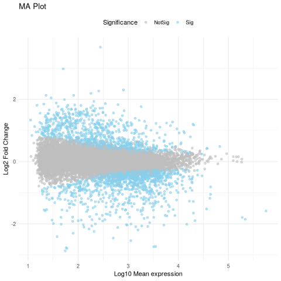
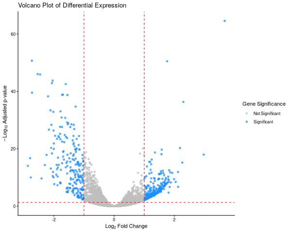
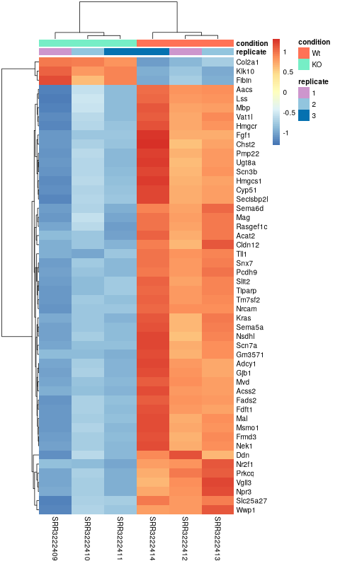

## Introduction

This is a **terminal-based lab**. The Quarto page is a guide: you do not run any of its code blocks in Quarto. Copy commands into your terminal, and create the Bash scripts using `nano` as instructed. In the DESeq2 and bonus sections, we will run the supplied R scripts using `Rscript`.

The workflow follows the same samples through quality control, alignment, counting and differential expression. At each step, pay attention to **what enters a tool, what comes out, and what its results mean**. We will use a small dataset to make the computations manageable.

Everything we will go through here today is adapted from the [NBIS RNAseq](https://nbisweden.github.io/workshop-ngsintro/2411/topics/rnaseq/lab_rnaseq.html) lab by Roy Francis and Dag Ahrén with some minor modifications.

We will go through:

- Check the quality of the raw reads with **FastQC (and MultiQC)**

- Map the reads to the reference genome using **HISAT2**

- Assess the post-alignment quality using **Qualimap** (or **Picard)**

- Count the reads overlapping with genes using **featureCounts**

- Find DE genes using **DESeq2** in R

**A note about the tools:** FastQC assesses the sequencing reads; HISAT2 aligns them to a genome; featureCounts assigns aligned reads/fragments to genes using an annotation; DESeq2 assesses evidence of expression changes. These tools do not all report the same quantity, so differences in their totals are often expected.

## The data

The data used in this exercise is from the paper: **Poitelon, Yannick, *et al*. YAP and TAZ control peripheral myelination and the expression of laminin receptors in Schwann cells. [Nature neuroscience 19.7 (2016): 879](https://www.nature.com/articles/nn.4316)**. In this study, YAP and TAZ genes were inactivated in Schwann cells to study myelination, using mice as a model.

Myelination is essential for nervous system function. Schwann cells are a type of glial cell that interact with neurons and the basal lamina to myelinate axons. Myelinated axons transfer signals up to 10x faster. Hippo pathway is a conserved pathway involved in cell contact inhibition, and it acts to promote cell proliferation and inhibits apoptosis. Transcription co-activators YAP and TAZ are two major downstream effectors of the Hippo pathway, and have redundant roles in transcriptional activation. TAZ and YAP genes were knocked-down to study their effect on neurons.

The material for RNA-seq was collected from 2 conditions (**Wt** and **KO**), each with 3 biological replicates.

| Accession  | Condition | Biological replicate |
|:-----------|:---------:|:--------------------:|
| SRR3222409 |    KO     |          1           |
| SRR3222410 |    KO     |          2           |
| SRR3222411 |    KO     |          3           |
| SRR3222412 |    Wt     |          1           |
| SRR3222413 |    Wt     |          2           |
| SRR3222414 |    Wt     |          3           |

For the alignment exercise, the reads have been downsampled and restricted to **chromosome 19** to keep the analysis fast. Later, we switch to an already prepared **whole-genome count matrix** before DESeq2, because a complete expression analysis should not be limited to a single chromosome. Keep this distinction in mind when examining output sizes and gene numbers.

## Exercises

### Create conda environment

First we need to set up our conda environment where we will install our tools and packages. First we will install mamba:

``` bash
conda install mamba -c conda-forge
```

Next we will download a file called environment.yaml, which specifies the packages and their version:

``` bash
wget https://github.com/ImmunTech/KIMN20/blob/main/transcriptomics/validation/environment.yml
```

To create a conda environment using an environment.yaml file we do:

``` bash
mamba env create -f environment.yml
```

Now we can activate it:

``` bash
conda activate rnaseq_lab
```

We will also set R paths so R looks in the correct library path

``` bash
# Unset the R_LIBS_USER variable to stop R from leaking into system paths
export R_LIBS_USER=""

# Prevent R from loading user-level site libraries
export R_LIBS_SITE=""
```

### **Set up working directory**

Before beginning, open a Linux terminal and activate the RNA-seq environment provided for the course, if needed (for example, `conda activate rnaseq_lab`). You will remain in the terminal throughout the exercises. Use `pwd` to print the current directory, `ls` to list its contents and `cd` to change directories. All relative paths in the examples depend on being in the indicated folder.

First we will set up the directory so we can have a clear structure over each step and files generated. We will first create a folder called `rnaseq` in your home directory

``` bash
cd ~
mkdir -p rnaseq
```

Create the directory structure as shown below.

Each folder corresponds to a stage in the analysis. The `scripts` folder stores commands you write; the numbered folders store the data or results produced by each program. Separating inputs and outputs makes it easier to locate files and debug problems.

``` text
rnaseq/
  +-- 1_raw/
  +-- 2_fastqc/
  +-- 3_mapping/
  +-- 4_dge/
  +-- 5_multiqc/
  +-- reference/
  |   +-- mouse_chr19_hisat2/
  +-- scripts/
  +-- funannot/
  +-- plots
```

``` bash
cd rnaseq
mkdir 1_raw 2_fastqc 3_mapping 4_dge 5_multiqc reference scripts funannot plots
cd reference
mkdir mouse_chr19_hisat2
cd ..
```

#### **Download the data**

FASTQ files contain sequencing reads and their base-quality scores. The suffix `_1` identifies the first read in a pair and `_2` the second. Both must be kept together during paired-end alignment. The `.gz` extension indicates compression; FastQC and HISAT2 can usually read these files without manually uncompressing them.

We will have to download the fastq files.

Navigate to the `1_raw` folder. If you have followed the steps above, you are currently in `~/rnaseq`:

``` bash
cd 1_raw/
```

Then download the fastq files. You can either run each command at a time or copy them and put them in a bash script (see below)

``` bash
wget https://github.com/Nilsson-D/dummy_data/raw/refs/heads/main/RNA-seq/data/SRR3222409-19_1.fq.gz
wget https://github.com/Nilsson-D/dummy_data/raw/refs/heads/main/RNA-seq/data/SRR3222409-19_2.fq.gz 
wget https://github.com/Nilsson-D/dummy_data/raw/refs/heads/main/RNA-seq/data/SRR3222410-19_1.fq.gz 
wget https://github.com/Nilsson-D/dummy_data/raw/refs/heads/main/RNA-seq/data/SRR3222410-19_2.fq.gz
wget https://github.com/Nilsson-D/dummy_data/raw/refs/heads/main/RNA-seq/data/SRR3222411-19_1.fq.gz 
wget https://github.com/Nilsson-D/dummy_data/raw/refs/heads/main/RNA-seq/data/SRR3222411-19_2.fq.gz
wget https://github.com/Nilsson-D/dummy_data/raw/refs/heads/main/RNA-seq/data/SRR3222412-19_1.fq.gz 
wget https://github.com/Nilsson-D/dummy_data/raw/refs/heads/main/RNA-seq/data/SRR3222412-19_2.fq.gz
wget https://github.com/Nilsson-D/dummy_data/raw/refs/heads/main/RNA-seq/data/SRR3222413-19_1.fq.gz 
wget https://github.com/Nilsson-D/dummy_data/raw/refs/heads/main/RNA-seq/data/SRR3222413-19_2.fq.gz
wget https://github.com/Nilsson-D/dummy_data/raw/refs/heads/main/RNA-seq/data/SRR3222414-19_1.fq.gz 
wget https://github.com/Nilsson-D/dummy_data/raw/refs/heads/main/RNA-seq/data/SRR3222414-19_2.fq.gz
```

To create the script go to the `scripts` folder

``` bash
cd ../scripts
```

Then using `nano get_data.sh`. Copy the links:

`nano` opens a terminal text editor. Paste the commands into the new file, press **Ctrl+O** followed by Enter to save, and **Ctrl+X** to exit. The first line (`#!/bin/bash`) marks the file as a Bash script. A script is useful because it records exactly how the data were obtained and can be rerun if necessary.

``` bash
#!/bin/bash

wget https://github.com/Nilsson-D/dummy_data/raw/refs/heads/main/RNA-seq/data/SRR3222409-19_1.fq.gz
wget https://github.com/Nilsson-D/dummy_data/raw/refs/heads/main/RNA-seq/data/SRR3222409-19_2.fq.gz 
wget https://github.com/Nilsson-D/dummy_data/raw/refs/heads/main/RNA-seq/data/SRR3222410-19_1.fq.gz 
wget https://github.com/Nilsson-D/dummy_data/raw/refs/heads/main/RNA-seq/data/SRR3222410-19_2.fq.gz
wget https://github.com/Nilsson-D/dummy_data/raw/refs/heads/main/RNA-seq/data/SRR3222411-19_1.fq.gz 
wget https://github.com/Nilsson-D/dummy_data/raw/refs/heads/main/RNA-seq/data/SRR3222411-19_2.fq.gz
wget https://github.com/Nilsson-D/dummy_data/raw/refs/heads/main/RNA-seq/data/SRR3222412-19_1.fq.gz 
wget https://github.com/Nilsson-D/dummy_data/raw/refs/heads/main/RNA-seq/data/SRR3222412-19_2.fq.gz
wget https://github.com/Nilsson-D/dummy_data/raw/refs/heads/main/RNA-seq/data/SRR3222413-19_1.fq.gz 
wget https://github.com/Nilsson-D/dummy_data/raw/refs/heads/main/RNA-seq/data/SRR3222413-19_2.fq.gz
wget https://github.com/Nilsson-D/dummy_data/raw/refs/heads/main/RNA-seq/data/SRR3222414-19_1.fq.gz 
wget https://github.com/Nilsson-D/dummy_data/raw/refs/heads/main/RNA-seq/data/SRR3222414-19_2.fq.gz
```

Save the script and head back to the `1_raw/` folder

``` bash
cd ../1_raw
```

Then run the script

``` bash
bash ../scripts/get_data.sh
```

Check the result with `ls -lh`. You should have 12 FASTQ files, two for each of the six samples.

### **FastQC**

**What are we checking?** FastQC evaluates individual FASTQ files; it does **not** map reads or measure gene expression. Its modules cover read quality across cycles, base composition, sequence duplication, adapter content and other sequence-level properties. Some warnings may arise from the biology or the library preparation and should be interpreted rather than treated as automatic failures.

**Quality check using FastQC**

After receiving raw reads from a high throughput sequencing centre it is essential to check their quality. [FastQC](http://www.bioinformatics.babraham.ac.uk/projects/fastqc/) provides a simple way to do some quality control check on raw sequence data. It provides a modular set of analyses which you can use to get a quick impression of whether your data has any problems of which you should be aware before doing any further analysis.

Change into the `2_fastqc` directory. Use `pwd` to check if you are standing in the correct directory.

``` bash

cd ../2_fastqc
pwd
```

`/home/<your-user>/rnaseq/2_fastqc` (replace with your own username)

The command to run FastQC is following (when in the directory given above)

``` bash

fastqc --outdir . ../1_raw/filename.fq.gz
```

The --outdir`.` flag tells FastQC to write its output to `.` (the current directory). In the next example, `*.fq.gz` expands to all matching FASTQ files, so it processes both mates of each sample.

Or we can specify all at once

``` bash
fastqc --outdir . ../1_raw/*.fq.gz
```

We will make a small script to keep track on the commands.

If we navigate to the scripts directory

``` bash
cd ../scripts
```

and then using nano to create a file `fastqc.sh`

``` bash
nano fastqc.sh
```

Then add the lines below and save the file:

``` bash
#!/bin/bash

# run from directory 2_fastqc/

fastqc --outdir . ../1_raw/*.fq.gz
```

This script executes fastqc on all the files ending with `.fq.gz`.

Change to the `2_fastqc` directory. Use `pwd` to check if you are standing in the correct directory. Run the script file `fastqc.sh`

``` bash
cd ../2_fastqc
pwd
```

`/home/<your-user>/rnaseq/2_fastqc`

``` bash
bash ../scripts/fastqc.sh
```

After the FastQC run, there should be a `.zip` file and an `.html` report for every FASTQ file. The HTML report is the one you can open in a web browser. We will compare all the samples together when we run MultiQC.

**Inspect the output:** Open one HTML report and look at *Per base sequence quality* and *Adapter Content*. In the quality plot, position is the sequencing cycle and the quality scores represent the confidence in individual base calls (Phred scale). Also look for any clearly different samples. We will summarize all reports with MultiQC later; for now, the goal is to understand what FastQC measures.

**Remember:** A FastQC warning is not the same as an alignment failure or a differentially expressed gene. Each tool answers a different question.

### **HISAT2**

A read is usually shorter than a gene, so alignment is the step that identifies where each sequenced fragment likely originated in the reference genome. HISAT2 is *splice aware*: it can align reads that cross exon–exon junctions, which is important because RNA has been spliced but the reference genome contains introns.

**Mapping reads using HISAT2**

After verifying that the quality of the raw sequencing reads is acceptable, we will map the reads to the reference genome. There are many mappers/aligners available, so it may be good to choose one that is adequate for your type of data. Here, we will use a software called [HISAT2](http://www.ccb.jhu.edu/software/hisat/index.shtml) (Hierarchical Indexing for Spliced Alignment of Transcripts) as it is a good general purpose splice-aware aligner. It is fast and does not require a lot of RAM. Before we begin mapping, we need to obtain genome reference sequence (`.fasta` file) and build an aligner index. Due to time constraints, we will build an index only on chromosome 19.

#### **Get reference**

The reference FASTA contains genome sequence. The GTF contains genomic coordinates and gene/transcript/exon annotations. For consistent results, the genome assembly and annotation should correspond to the same Ensembl release. Here we use Ensembl release 99 (GRCm38) to match the original example.

It is best if the reference genome (`.fasta`) and annotation (`.gtf`) files come from the same source to avoid potential naming conventions problems. It is also good to check in the manual of the aligner you use for hints on what type of files are needed to do the mapping. We will not be using the annotation (`.gtf`) during mapping, but we will use it during quantification.

Check out the [HISAT2 manual](http://www.ccb.jhu.edu/software/hisat/manual.shtml) indexer section for information. Browse through [Ensembl](https://www.ensembl.org/) and try to find the files needed. Note that we are working with Mouse (*Mus musculus*).

Move into the `reference` directory and download the Chr 19 genome (`.fasta`) file and the genome-wide annotation file (`.gtf`) from Ensembl.

Move from `2_fastqc` to the `reference` directory. Confirm your location:

``` bash
cd ../reference
pwd
```

`/home/<your-user>/rnaseq/reference`

Then run `wget` with the links below to download the reference genome and annotations.

``` bash
wget https://ftp.ensembl.org/pub/release-99/fasta/mus_musculus/dna/Mus_musculus.GRCm38.dna.chromosome.19.fa.gz
wget https://ftp.ensembl.org/pub/release-99/gtf/mus_musculus/Mus_musculus.GRCm38.99.gtf.gz
```

You are most likely to use the [latest version](https://www.ensembl.org/) of ensembl release genome and annotations when starting a new analysis. For this exercise, we will use ensembl version 99.

Decompress the files for use.

`gunzip` expands the downloaded compressed files. The FASTA is needed for index building; the GTF is needed later to count alignments overlapping exons. A genome without an annotation can still be aligned to, but it does not tell featureCounts which regions should be treated as genes.

``` bash
gunzip Mus_musculus.GRCm38.dna.chromosome.19.fa.gz
gunzip Mus_musculus.GRCm38.99.gtf.gz
```

From the full gtf file, we will also extract chr 19 alone to create a new gtf file for use later.

The command below keeps GTF comment lines (beginning with `#`) and records for chromosome `19`. It is useful to have a chromosome-specific annotation when assessing the chromosome-19 alignments, although the main featureCounts script uses the full GTF annotation.

``` bash
cat Mus_musculus.GRCm38.99.gtf | grep -E "^#|^19" > Mus_musculus.GRCm38.99-19.gtf
```

The `grep` command is set to use regular expression with the `-E` argument. And it’s looking for lines starting with `#` or `19`. `#` fetches the header and comments while `19` denotes all rows with annotations for chromosome 19.

Check what you have in your directory.

``` bash
ls -l
```

``` text
drwxrwxr-x 2 user user 4.0K Nov  7 12:21 mouse_chr19_hisat2
-rwxrwxr-x 1 user user  26M Nov  7 12:06 Mus_musculus.GRCm38.99-19.gtf
-rwxrwxr-x 1 user user 771M Nov  7 12:06 Mus_musculus.GRCm38.99.gtf
-rwxrwxr-x 1 user user  60M Nov  7 12:06 Mus_musculus.GRCm38.dna.chromosome.19.fa
```

#### **Build index**

HISAT2 does not search the unindexed FASTA from scratch for every read. The index is a set of data structures built once from the genome that makes later alignments much faster. The `.ht2` files you will see are the index components and not aligned reads.

While in `reference`, create a new Bash script in the `scripts` folder:

``` bash
nano ../scripts/hisat2_index.sh
```

Paste the following lines into the file and save it:

``` bash
#!/bin/bash

hisat2-build \
  -p 1 \
  Mus_musculus.GRCm38.dna.chromosome.19.fa \
  mouse_chr19_hisat2/mouse_chr19_hisat2
```

The above script builds a HISAT2 index using the command `hisat2-build`. It should use 1 core for computation. The paths to the FASTA (.fa) genome file is specified. And the output path is specified. The output describes the output directory and the prefix for output files. The output directory must be present before running this script. Check `hisat2-build --help` for the arguments and descriptions.

Run the script **while standing in `reference`** (the relative paths inside the script assume this is the working directory):

``` bash
bash ../scripts/hisat2_index.sh
```

Once the indexing is complete, move into the `mouse_chr19_hisat2` directory and make sure you have all the files.

``` bash
ls -l mouse_chr19_hisat2/
```

There should be eight `.ht2` files. Their number and sizes are expected to differ; together, they make up the index. You build this index once, then reuse it for every sample.

``` text
-rw-rw-r-- 1 user user 23596561 Nov  7 12:21 mouse_chr19_hisat2.1.ht2
-rw-rw-r-- 1 user user 14551472 Nov  7 12:21 mouse_chr19_hisat2.2.ht2
-rw-rw-r-- 1 user user       53 Nov  7 12:20 mouse_chr19_hisat2.3.ht2
-rw-rw-r-- 1 user user 14551464 Nov  7 12:20 mouse_chr19_hisat2.4.ht2
-rw-rw-r-- 1 user user 25552929 Nov  7 12:21 mouse_chr19_hisat2.5.ht2
-rw-rw-r-- 1 user user 14817982 Nov  7 12:21 mouse_chr19_hisat2.6.ht2
-rw-rw-r-- 1 user user       12 Nov  7 12:20 mouse_chr19_hisat2.7.ht2
-rw-rw-r-- 1 user user        8 Nov  7 12:20 mouse_chr19_hisat2.8.ht2
```

The index for the whole genome would be created in a similar manner. It just requires more time to run.

#### **Map reads**

For paired-end data, one alignment command takes both FASTQ files belonging to the same sample. HISAT2 reports mapping statistics, while the alignment records themselves are saved in SAM/BAM format.

Now that we have the index ready, we are ready to map reads. Move from `reference` to the directory `3_mapping` and check your location:

``` bash
cd ../3_mapping
pwd
```

You should be standing here to run this:

`/home/<your-user>/rnaseq/3_mapping`

These are the parameters that we want to specify for the mapping run:

- Specify the number of threads

- Specify the full genome index path

- Specify a summary file

- Indicate read1 and read2 since we have paired-end reads

- Direct the output (SAM) to a file

HISAT2 aligner arguments can be obtained by running `hisat2 --help`. We should end with a script that looks like below to run one of the samples (**Don´t run this**).

``` bash
hisat2 \
  -p 1 \
  -x ../reference/mouse_chr19_hisat2/mouse_chr19_hisat2 \
  --summary-file "SRR3222409-19.summary" \
  -1 ../1_raw/SRR3222409-19_1.fq.gz \
  -2 ../1_raw/SRR3222409-19_2.fq.gz \
  -S SRR3222409-19.sam
```

Let’s break this down a bit. `-p` options denotes that it will use 1 thread. In a real world scenario, we might want to use 8 to 12 threads. `-x` denotes the full path (with prefix) to the aligner index we built in the previous step. `--summary-file` specifies a summary file to write alignments metrics such as mapping rate etc. `-1` and `-2` specifies the input fastq files. Both are used here because this is a paired-end sequencing. `-S` denotes the output SAM file.

But, we will not run it as above. We will make some more changes to it. We want to make the following changes:

- Rather than writing the output as a SAM file, we want to direct the output to another tool `samtools` to order alignments by coordinate and to export in BAM format

- Generalise the above script to be used as a bash script to read any two input files and to automatically create the output filename.

Now create a new Bash script file named `hisat2_align.sh` in your `scripts` directory:

``` bash
nano ../scripts/hisat2_align.sh
```

Add the script below to it:

``` bash
#!/bin/bash

# get output filename prefix
prefix=$( basename "$1" | sed -E 's/_.+$//' )

hisat2 \
  -p 1 \
  -x ../reference/mouse_chr19_hisat2/mouse_chr19_hisat2 \
  --summary-file "${prefix}.summary" \
  -1 "$1" \
  -2 "$2" | samtools sort -O BAM > "${prefix}.bam"
```

In the above script, the two input fastq files are not hard coded, rather we use `$1` and `$2` because they will be passed in as arguments.

The output filename prefix is automatically created using this line `prefix=$( basename $1 | sed -E 's/_.+$//' )` from input filename of `$1`. For example, a file with path `/bla/bla/sample_1.fq.gz` will have the directory stripped off using the function `basename` to get `sample_1.fq.gz`. This is piped (`|`) to `sed` where all text starting from `_` to end of string (specified by this regular expression `_.+$` matching `_1.fq.gz`) is removed and the prefix will be just `sample`. This approach will work only if your filenames are labelled suitably.

Lastly, the SAM output is piped (`|`) to the tool samtools for sorting and written in BAM format.

The key difference is between **SAM**, a text representation of alignments, and **BAM**, the compressed binary format. `samtools sort` writes alignments in coordinate order, which is required by several downstream tools. The `.summary` file is not a gene count table; it describes how the sequencing reads aligned.

Now we can run the bash script like below while standing in the `3_mapping` directory. OBS, sample_1.fq.gz sample_2.fq.gz needs to be changed. Or you can make a loop (see optional) to remove the need to write it out in the command line multiple times.

``` bash
bash ../scripts/hisat2_align.sh ../1_raw/SRR3222409-19_1.fq.gz ../1_raw/SRR3222409-19_2.fq.gz
```

Similarly run the other samples.

::: callout-note
#### Optional

Try to create a new bash loop script (`hisat2_align_batch.sh`) to iterate over all fastq files in the directory and run the mapping using the `hisat2_align.sh` script. Note that there is a bit of a tricky issue here. You need to use two fastq files (`_1` and `_2`) per run rather than one file. There are many ways to do this and here is one. run `nano ../scripts/hisat2_align_batch.sh` and add:

``` bash
#!/bin/bash

# Loop through each read1 file
for r1 in ../1_raw/*1.fq.gz; do
  # Define the corresponding read2 file by replacing "r1" with "r2" in the filename
  
  r2="${r1/_1.fq.gz/_2.fq.gz}"

  echo "Mapping ${r1} and ${r2} ..."
  bash ../scripts/hisat2_align.sh "$r1" "$r2"
done
```

Run the `hisat2_align_batch.sh` script in the `3_mapping` directory.

``` bash
bash ../scripts/hisat2_align_batch.sh
```
:::

At the end of the mapping jobs, you should have the corresponding BAM and summary files for every sample (the example below shows one sample):

``` bash
ls -l
```

``` text
-rw-rw-r-- 1 user user  9726043 Nov  7 12:36 SRR3222409-19.bam
-rw-rw-r-- 1 user user      608 Nov  7 12:36 SRR3222409-19.summary
```

The `.bam` file contains the alignment of all reads to the reference genome in binary format. BAM files are not human readable directly. To view a BAM file in text format, you can use `samtools view` functionality.

``` bash
samtools view SRR3222409-19.bam | head
```

``` text
SRR3222409.13658290     163     19      3084385 60      95M3S   =       3084404 120     CTTTAAGATAAGTGCCGGTTGCAGCCAGCTGTGAGAGCTGCACTCCCTTCTCTGCTCTAAAGTTCCCTCTTCTCAGAAGGTGGCACCACCCTGAGCTG  DB@D@GCHHHEFHIIG<CHHHIHHIIIIHHHIIIIGHIIIIIFHIGHIHIHIIHIIHIHIIHHHHIIIIIIHFFHHIIIGCCCHHHH1GHHIIHHIII  AS:i:-3 ZS:i:-18        XN:i:0  XM:i:0  XO:i:0  XG:i:0  NM:i:0  MD:Z:95 YS:i:-6 YT:Z:CP NH:i:1
SRR3222409.13658290     83      19      3084404 60      101M    =       3084385 -120    TGCAGCCAGCTGTGAGAGCTGCACTCCCTTCTCTGCTCTAAAGTTCCCTCTTCTCAGAAGGTGGCACCACCCTGAGCTGCTGGCAGTGAGTCTGTTCCAAG       IIIIHECHHH?IHHHIIIHIHIIIHEHHHCHHHIHIIIHHIHIIIHHHHHHIHEHIIHIIHHIIHHIHHIGHIGIIIIIIIHHIIIHHIHEHCHHG@<<BD       AS:i:-6 ZS:i:-16        XN:i:0  XM:i:1  XO:i:0  XG:i:0  NM:i:1  MD:Z:76T24      YS:i:-3 YT:Z:CP     NH:i:1
SRR3222409.13741570     163     19      3085066 60      15M2I84M        =       3085166 201     ATAGTACCTGGCAACAAAAAAAAAAAAGCTTTTGGCTAAAGACCAATGTGTTTAAGAGATAAAAAAAGGGGTGCTAATACAGAAGCTGAGGCCTTAGAAGA       0B@DB@HCCH1<<CGECCCGCHHIDD?01<<G1</<1<FH1F11<1111<<<<11<CGC1<G1<F//DHHI0/01<<1FG11111111<111<1D1<1D1<       AS:i:-20        XN:i:0  XM:i:3  XO:i:1  XG:i:2  NM:i:5  MD:Z:40T19C27T10        YS:i:0      YT:Z:CP NH:i:1
SRR3222409.1587123      99      19      3085139 60      100M    =       3085419 381     AATACAGAAGCTGAGTCCTTAGAAGAGTCCGGTGGCCTACCTGTTGAAGCAGCTAGAAAAAGAGACTGTGTTTCATACTCCTCCACCGACCAGTGCAAAA        DDDDDIHIIHIIIIIHHIIIIIIIIIIIIIIIIHIIIIIIIIIIIIIIIIIIIIIIIIIIIIIIIGIIIIIIIHIIIIIIIIIIIIIIIIIIIIIIIIEH        AS:i:0  XN:i:0  XM:i:0  XO:i:0  XG:i:0  NM:i:0  MD:Z:100        YS:i:0  YT:Z:CP NH:i:1
SRR3222409.13741570     83      19      3085166 60      101M    =       3085066 -201    TCCGGTGGCCTACCTGTTGAAGCAGCTAGAAAAAGAGACTGTGTTTCATACTCCTCCACCGACCAGTGCAAAACAAGCTAAAAAGTTCCTGGGCACTGCGG       ?C?FHEHEHCGFC@EHFHHH@IIHFFEFHFFF<<CCGCFHG<CF@@EGHFHCCHHEHEDC@DFCIHEHFEHGCFEIIH?HHCG@HHE@FGCHEIHCDDD@D       AS:i:0  XN:i:0  XM:i:0  XO:i:0  XG:i:0  NM:i:0  MD:Z:101        YS:i:-20        YT:Z:CP NH:i:1
SRR3222409.1587123      147     19      3085419 60      101M    =       3085139 -381    AACAAAGGTATTGTCAAAGAAGTTCTTACTCAGAGATTGGGACCCTAGAAAAGACCTGTGGCATACTTGTAAAAAATTAGACCTGGTGGCTGTAGGATGGC       IIIIIIIIIIIIIIIIHIIIIIIIIIIHIIIIIIIIIIIIIIIIIHIIIIIGIHIIIIIIIIIIIIIIIIIIIIIIIIIIIIIIIIIIIIIIIIIIDDDDD       AS:i:0  XN:i:0  XM:i:0  XO:i:0  XG:i:0  NM:i:0  MD:Z:101        YS:i:0  YT:Z:CP NH:i:1
SRR3222409.3749473      99      19      3086400 60      101M    =       3086674 375     CCAAAAGCAATAGTGTCAGATAATGGTCCTGTCTTTGTTGCCCAGGTAAGTCAGGGTGTGGCCAAGTATTTAGAGGTCAAATAAAAATTGTACAGACCTCA       DBDDBHE?FCGFEGHII?FHIHIHHIHIEEH<FHGH?HGEHIIIG?GHIHIIIE?GFHHIHEHIIIHE<CFHHFHCF11FGHCHHHEC<FGH?GE@<GHIH       AS:i:0  XN:i:0  XM:i:0  XO:i:0  XG:i:0  NM:i:0  MD:Z:101        YS:i:0  YT:Z:CP NH:i:1
SRR3222409.15573439     163     19      3086425 60      101M    =       3086496 172     GTCCTGTCTTTGTTGCCCAGGTAAGTCAGGGTGTGGCCAAGTATTTAGAGGTCAAATAAAAATTGTACAGACCTCAGAACTCAGGACAGATAGAAATAATA       DDDB@CHIIGHCGE@HIHHHIIHHHCDHHIHFCHHHEHHCGCHFHHHHHHEHHEFFHHIHIIIIHIHHHIIHFFHEHHHHIGEHHEHCHHHHH?HHHIHIE       AS:i:0  XN:i:0  XM:i:0  XO:i:0  XG:i:0  NM:i:0  MD:Z:101        YS:i:0  YT:Z:CP NH:i:1
SRR3222409.15573439     83      19      3086496 60      101M    =       3086425 -172    CCTCAGAACTCAGGACAGATAGAAATAATAAATAAAACTCTAAACAGACCTTGACAAAATTAATCCTAGAGACTGGCACAGACTTACTTGGTGCCCCTTCC       GCF1G?IHEHF<1CCHD1?CGECF<1<@CCC@F<<1<<1<<<D<GF<<C<1<1<1GF1C<<11<CCC<<11DC<<@FCGD1<<1F<<1<1<CC/0@DD0D<       AS:i:0  ZS:i:-16        XN:i:0  XM:i:0  XO:i:0  XG:i:0  NM:i:0  MD:Z:101        YS:i:0  YT:Z:CP     NH:i:1
SRR3222409.3749473      147     19      3086674 60      101M    =       3086400 -375    TGCCCATCACTGTCTTAAATAATGTGTTTAAACCTATGTTGTTATAATAATGATCTGTATACTAAGTTATAAGGCTTACAGGTGGTGCAGAAAGAAGTCTG       11C?HC1@D1111C<C1FEH@?D1F<DHF<<<EHGD<11@G@EH?HG<G@@HHIHHCCCCC?HHD<C@F<@?G1?HC<<1<1?IHGHCC1HEHHEC@@D0B       AS:i:0  XN:i:0  XM:i:0  XO:i:0  XG:i:0  NM:i:0  MD:Z:101        YS:i:0  YT:Z:CP NH:i:1
```

The summary file describes the alignment run. It is also collected later by MultiQC. **Inspect one of the summaries** and locate the number of pairs aligned concordantly exactly once, more than once, and not at all. *Concordant* means the mates align in an expected paired-end arrangement. The reported **overall alignment rate** is not the percentage of reads assigned to genes; those are different statistics.

``` bash
cat SRR3222409-19.summary
```

**How to read the example:** The `156992` at the start counts *read pairs* in this output, whereas later percentages can concern paired alignment outcomes or individual mates. Because reads can be multiply mapped or aligned discordantly, don't add together percentages from different levels of the report as though they shared a single denominator.

``` text
156992 reads; of these:
  156992 (100.00%) were paired; of these:
    7976 (5.08%) aligned concordantly 0 times
    147178 (93.75%) aligned concordantly exactly 1 time
    1838 (1.17%) aligned concordantly >1 times
    ----
    7976 pairs aligned concordantly 0 times; of these:
      693 (8.69%) aligned discordantly 1 time
    ----
    7283 pairs aligned 0 times concordantly or discordantly; of these:
      14566 mates make up the pairs; of these:
        5973 (41.01%) aligned 0 times
        4078 (28.00%) aligned exactly 1 time
        4515 (31.00%) aligned >1 times
98.10% overall alignment rate
```

#### **Understanding the HISAT2 alignment summary**

HISAT2 produces a summary describing how successfully the sequencing reads were aligned to the reference genome. Since we are working with **paired-end sequencing**, each fragment is represented by two reads (also called *mates*), one from each end of the fragment.

HISAT2 first tries to align both reads together as a pair. If this is unsuccessful, it attempts other alignment strategies. The summary therefore contains several levels:

- **Aligned concordantly exactly 1 time:** Both reads align together in the expected orientation and distance, and the pair has one valid alignment.

- **Aligned concordantly \>1 times:** Both reads align together as expected, but the pair has multiple possible alignment positions. This can occur in repetitive or highly similar genomic regions.

- **Aligned concordantly 0 times:** No valid concordant alignment was found for the pair. **This does not necessarily mean that neither read could be aligned.**

For pairs without a concordant alignment, HISAT2 then reports:

- **Aligned discordantly 1 time:** Both reads could be aligned, but not in the expected paired-end arrangement (for example, their orientation or distance was unexpected).

- **Mates aligned individually:** For the remaining pairs, HISAT2 reports whether each individual read aligned zero, one, or multiple times.

**How do we interpret our example?**

We started with **156,992 read pairs**, corresponding to 313,984 individual reads.

Of these pairs:

- **93.75%** aligned concordantly exactly once.

- **1.17%** aligned concordantly more than once.

- **5.08%** did not align concordantly and were examined further.

Among the 7,976 pairs without a concordant alignment, 693 aligned discordantly. The remaining 7,283 pairs were examined as 14,566 individual reads, of which 5,973 did not align at all.

The **overall alignment rate of 98.10%** represents the percentage of individual reads that could be aligned at least once, including reads aligned as concordant pairs, discordant pairs, or individually.

An important distinction is that **the overall alignment rate is not the same as the percentage of uniquely mapped read pairs**. It includes reads that map to multiple locations.

Also, a high mapping rate does not necessarily mean that all reads can be assigned to genes. We will investigate this distinction later when using featureCounts.

Next, we need to index these BAM files. Indexing creates `.bam.bai` files which are required by many downstream programs to quickly and efficiently locate reads anywhere in the BAM file.

Index all BAM files. Write a for-loop to index all BAM files using the command `samtools index file.bam`. In the `scripts` directory, create a file `samtools_index_bam.sh`

``` bash
#!/bin/bash

for i in *.bam
  do
    echo "Indexing $i ..."
    samtools index $i
  done
```

And run it in the `3_mapping/`

``` bash
bash ../scripts/samtools_index_bam.sh
```

Now, we should have `.bai` index files for all BAM files.

`samtools index` does not change the original BAM alignments. It creates a lookup index (`.bam.bai`) so programs can quickly retrieve alignments at selected genomic positions. Do not confuse the BAM index with the HISAT2 **genome** index: they serve different purposes.

``` bash
ls -l
```

``` text
-rw-rw-r-- 1 user user  9726043 Nov  7 12:36 SRR3222409-19.bam
-rw-rw-r-- 1 user user    43848 Nov  7 12:41 SRR3222409-19.bam.bai
```

### **featureCounts**

**What happens here?** HISAT2 answers *where the reads map*; featureCounts asks *which annotated genes those mapped reads overlap*. To do this, it combines the BAM alignments with the GTF gene annotation. Some alignments will remain unassigned because they fall outside annotated exons, are ambiguous or do not satisfy counting rules. These are not necessarily sequencing errors.

**Counting mapped reads using featureCounts**

After ensuring mapping quality, we can move on to enumerating reads mapping to genomic features of interest. Here we will use **featureCounts**, an ultrafast and accurate read summarisation program, that can count mapped reads for genomic features such as genes, exons, promoter, gene bodies, genomic bins and chromosomal locations.

Read featureCounts [documentation](http://subread.sourceforge.net/SubreadUsersGuide.pdf) and see if you can figure it out how to use paired-end reads using an unstranded library to count fragments overlapping with exonic regions and summarise over genes.

Create a Bash script named `featurecounts.sh` in the directory `scripts`:

``` bash
nano ../scripts/featurecounts.sh
```

We could run featureCounts on each BAM file, produce a text output for each sample and combine the output. But the easier way is to provide a list of all BAM files and featureCounts will combine counts for all samples into one text file.

Below is the script that we will use:

``` bash
#!/bin/bash

featureCounts \
  -a "../reference/Mus_musculus.GRCm38.99.gtf" \
  -o "counts.txt" \
  -F "GTF" \
  -t "exon" \
  -g "gene_id" \
  -p \
  --countReadPairs \
  -s 0 \
  -T 1 \
  ../3_mapping/*.bam
```

In the above script, we indicate the path of the annotation file (`-a "../reference/Mus_musculus.GRCm38.99.gtf"`), specify the output file name (`-o "counts.txt"`), specify that that annotation file is in GTF format (`-F "GTF"`), specify that reads are to be counted over exonic features (`-t "exon"`) and summarised to the gene level (`-g "gene_id"`). We also specify paired-end input (`-p`), count **read pairs/fragments rather than individual reads** (`--countReadPairs` in newer featureCounts versions), an unstranded library (`-s 0`) and one thread (`-T 1`). Because a pair originates from one sequenced fragment, counting fragments is typically the relevant unit for paired-end RNA-seq libraries.

Run the script from the directory `4_dge` (you are currently in `3_mapping`):

``` bash
cd ../4_dge
pwd
```

::: callout-important
Make sure you do not have any empty bam files in the 3_mapping folder before running the script!
:::

You should be standing here to run this:

``` bash
bash ../scripts/featurecounts.sh
```

**Inspect the result:** featureCounts produces `counts.txt` (gene-by-sample count matrix) and `counts.txt.summary` (why reads or fragments were assigned or not assigned). Try:

``` bash
head -n 4 counts.txt
cat counts.txt.summary
```

Rows represent genes identified by `gene_id` in the annotation. The sample columns correspond to the BAM input files. The `Assigned` value in the summary is a **counting** statistic, not a HISAT2 mapping rate. In the current pipeline, the chr19-only counts will also be substantially smaller than the full-genome counts used next.

You should have two output files:

``` bash
ls -l
```

::: callout-important
#### Important

For downstream steps, we will NOT use this `counts.txt` file. Instead we will use **`counts_full.txt`** from the back-up folder. This contains counts across all chromosomes. This is located [here](https://raw.githubusercontent.com/Nilsson-D/dummy_data/refs/heads/main/RNA-seq/counts_full.txt). Download this file to your `4_dge` directory.

``` bash
wget https://raw.githubusercontent.com/Nilsson-D/dummy_data/refs/heads/main/RNA-seq/counts_full.txt
```

This change of input is intentional: `counts.txt` shows that you can produce gene counts yourself from the chromosome-19 BAMs; `counts_full.txt` is provided so the statistical analysis can use counts across the complete genome, avoiding the limitations of the teaching-sized alignment data.
:::

### **MultiQC**

MultiQC is a **report aggregator**, not an additional alignment or counting algorithm. It scans files produced by programs such as FastQC, HISAT2 and featureCounts and summarizes their metrics in one HTML report. You may see different sample totals across panels because they refer to different stages of processing or counting units.

**Combined QC report using MultiQC**

We will use **MultiQC** to collect available log files and outputs from FastQC, HISAT2 and featureCounts into a combined QC report. Move to `5_multiqc`:

``` bash
cd ../5_multiqc
```

You should be standing here to run this:

`/home/<your-user>/rnaseq/5_multiqc`

And run this in the terminal.

``` bash
multiqc -interactive ../
```

``` text
/// MultiQC 🔍 v1.35

     update_config | Report title: nteractive
       file_search | Search path: /home/danielni/rnaseq
         searching | ━━━━━━━━━━━━━━━━━━━━━━━━━━━━━━━━━━━━━━━━ 100% 74/74  
     featurecounts | Found 6 reports
           bowtie2 | Found 6 reports
            fastqc | Found 12 reports
     write_results | Data        : nteractive_multiqc_report_data
     write_results | Report      : nteractive_multiqc_report.html
           multiqc | MultiQC complete
```

The output should look similar to the example below:

``` bash
ls -l
```

``` text
drwxrwxr-x 2 user user    4096 Nov  7 12:57 multiqc_data
-rw-rw-r-- 1 user user 4893813 Nov  7 12:57 multiqc_report.html
```

You can open the HTML files in a browser.

**What to look at:** Start with the general FastQC quality overview, then the alignment and featureCounts summaries. Is there any sample that stands out? Try to interpret the metric definitions before deciding whether differences imply a problem. A high alignment percentage does not guarantee that a similarly high percentage will be assigned to annotated exons. The important question is whether the files behave as expected **for the corresponding stage**.

Some MultiQC versions show HISAT2 summaries under a Bowtie2-family panel because the log formats are related. The name of that panel does not mean you ran a different aligner.

### **DESeq2**

This is where we move from processing sequencing reads to asking a biological question: **which genes differ between KO and Wt samples?** DESeq2 uses a model for *raw gene counts*, estimates sequencing-depth normalization factors and variability across biological replicates, then tests the difference between conditions. We only have two groups and will perform **one comparison: KO versus Wt**, as in the original lab.

**Differential gene expression using DESeq2**

The easiest way to perform differential expression is to use one of the statistical packages, within R environment, that were specifically designed for analyses of read counts arising from RNA-seq, SAGE and similar technologies. Here, we will use one such package called **DESeq2**. There is a prepared basic ready to run R scripts to find DE genes between conditions **KO** and **Wt**.

Move to the `4_dge` directory.

From `5_multiqc`, return to `4_dge`. Download the original prepared R script rather than rewriting the statistical analysis from scratch:

``` bash
cd ../4_dge
pwd
```

Then download `dge.R`:

``` bash
wget https://raw.githubusercontent.com/Nilsson-D/dummy_data/refs/heads/main/RNA-seq/scripts/R/dge.R
```

Make sure you have the `counts_full.txt`. If not, you can download it to `4_dge/counts_full.txt`

``` bash
wget https://raw.githubusercontent.com/Nilsson-D/dummy_data/refs/heads/main/RNA-seq/counts_full.txt
```

Now, run the R script from the shell in `4_dge` directory.

``` bash
Rscript dge.R
```

**What does `dge.R` do?** The script (1) loads the full-genome count matrix and metadata for the six samples, (2) checks/arranges the samples, (3) removes genes with very low counts, (4) estimates normalization factors and gene-wise dispersion, (5) fits a negative-binomial model with condition as the explanatory variable, and (6) writes the results and variance-stabilized data to files.

The reference group is **Wt**, so a **positive** `log2FoldChange` indicates higher estimated expression in KO and a negative value indicates higher expression in Wt. A value of `1` corresponds to a twofold difference; `-1` corresponds to half the expression in KO relative to Wt. Inference uses **all three biological replicates per condition**, not only a comparison of average counts.

You can inspect the script in the terminal using `less dge.R` (press `q` to exit) or `nano dge.R`.

This should have produced the following output files:

``` bash
ls -l
```

``` text
-rwxrwxr-x 1 user user   388352 Nov  7 13:46 counts_vst_full.Rds
-rwxrwxr-x 1 user user  1778560 Nov  7 13:46 counts_vst_full.txt
-rwxrwxr-x 1 user user   744884 Nov  7 13:46 dge_results_full.Rds
-rwxrwxr-x 1 user user  1879900 Nov  7 13:46 dge_results_full.txt
```

Essentially, we have two outputs: **dge_results_full** and **counts_vst_full**.

A few columns in `dge_results_full.txt` are worth understanding:

| Column | Meaning |
|:-----------------------------------|:-----------------------------------|
| `baseMean` | Average normalized expression across the six samples |
| `log2FoldChange` | Estimated KO-versus-Wt effect on a log2 scale (after the script's shrinkage step) |
| `lfcSE` | Uncertainty in the estimated log2 fold change |
| `pvalue` | Unadjusted test p-value |
| `padj` | P-value adjusted for testing many genes (Benjamini–Hochberg FDR) |

`counts_vst_full.txt` is **not** a second differential expression test. It contains expression values transformed to make the variability more suitable for plots such as PCA and heatmaps. The DESeq2 model is fitted to raw counts, not these VST values.

Use the terminal to see the file header and first results:

``` bash
head -n 6 dge_results_full.txt
head -n 3 counts_vst_full.txt
```

**One simple interpretation exercise:** Find a gene with `padj < 0.05`. Is its `log2FoldChange` positive or negative, and what does that mean for KO relative to Wt?

If you could not run the DGE step, you can download the prepared differential expression result for the optional enrichment exercise:

``` bash
wget https://raw.githubusercontent.com/Nilsson-D/dummy_data/refs/heads/main/RNA-seq/dge_results_full.txt
```

For the plotting exercise, make sure you have the **actual VST output generated by `Rscript dge.R`**. A raw featureCounts matrix renamed to `counts_vst_full.txt` is not equivalent to variance-stabilized data.

## Gene expression exploration

These sections extend the **same KO-versus-Wt analysis**. First, we look for biological processes among the DE genes. Then we visualize the results with the four figures from the original plotting script. They are optional: you do not need to perform new statistical contrasts.

### **Installing R packages**

Before continuing, make sure your RNA-seq environment includes the Bioconductor packages needed:

- goseq

- reactome.db

- org.Mm.eg.db

- EnsDb.Mmusculus.v79

You can check them from the terminal without opening RStudio:

``` bash
Rscript -e 'pkgs <- c("goseq", "reactome.db", "org.Mm.eg.db", "EnsDb.Mmusculus.v79", "GO.db"); print(sapply(pkgs, requireNamespace, quietly=TRUE))'
```

If a package is missing, use the course environment instructions or ask the instructor before running the bonus script.

### **Functional annotation**

In this part of the exercise we will address the question which biological processes are affected in the experiment; in other words we will functionally annotate the results of the analysis of differential gene expression (performed in the main part of the exercise). We will use **Gene Ontology (GO)** and **Reactome** databases.

When performing this type of analysis, one has to keep in mind that the analysis is only as accurate as the annotation available for your organism. So, if working with non-model organisms which may have relatively few experimentally validated annotations, the results may not be fully reflecting the actual situation.

There are many methods for asking which biological processes and pathways are over-represented among the differentially expressed genes, compared with the genes tested in the DE analysis. They use several types of statistical tests (e.g. hypergeometric test, Fisher’s exact test etc.), and many have been developed with microarray data in mind. Not all of these methods are appropriate for RNA-seq data, which as you remember from the lecture, exhibit length bias in power of detection of differentially expressed genes (i.e. longer genes, which tend to gather more reads, are more likely to be detected as **differentially expressed** than shorter genes, solely because of the length).

We will use the R / Bioconductor package **goseq**, designed to perform RNA-seq enrichment analyses while accounting for the tendency of longer genes to be more easily detected as DE. The script uses one list of genes higher in KO and one lower in KO; these are derived from **the same differential expression comparison**, not separate RNA-seq models.

In this part, we will use the same data as in the main workflow. The starting point of the exercise is the file with results of the differential expression produced in the main part of the exercise.

#### **Preparation**

Change from `4_dge` to the `funannot` directory:

``` bash
cd ../funannot
```

Download the `annotate_de_results.R` to your `rnaseq/funannot` directory

``` bash
wget https://raw.githubusercontent.com/Nilsson-D/dummy_data/refs/heads/main/RNA-seq/scripts/R/annotate_de_results.R
```

We also need a BioMart gene annotation table matching the IDs in the DESeq2 output. Download `mm-biomart99-genes.txt` into **`reference`**, not the current `funannot` folder:

``` bash
wget -P ../reference/ https://raw.githubusercontent.com/Nilsson-D/dummy_data/refs/heads/main/RNA-seq/mm-biomart99-genes.txt
```

You are still in `funannot`. Now run:

``` bash
Rscript annotate_de_results.R
```

The script reads **`dge_results_full.txt`** from `4_dge/` and the BioMart file from `reference/`, then writes enrichment tables into the current `funannot/` folder. It separates up- and down-regulated genes and looks at both GO terms and Reactome pathways.

``` bash
ls -l
```

``` text
-rw-rw-r-- 1 user user 2073787 Nov  7 14:17 go_down.txt
-rw-rw-r-- 1 user user 2085359 Nov  7 14:17 go_up.txt
-rw-rw-r-- 1 user user  163794 Nov  7 14:17 reactome_down.txt
-rw-rw-r-- 1 user user  157298 Nov  7 14:17 reactome_up.txt
```

#### **Interpretation**

The results are saved to four tables: GO terms for up-regulated genes (go_up.txt), GO terms for down-regulated genes (go_down.txt) and similarily, Reactome pathways for up-regulated genes (reactome_up.txt) and Reactome pathways for down-regulated genes (reactome_down.txt).

Take a quick look at some of these files.

``` bash
head go_up.txt 
```

**How to interpret:** A GO term describes a biological process, molecular function or cellular component. `numDEInCat` is the number of genes from the selected DE list annotated to the term; `numInCat` is the size of that term in the annotation universe. The `over_represented_pvalue` is evidence for enrichment, not the fold change of a pathway. Many terms overlap and are biologically related; avoid interpreting every row as an independent mechanism.

``` text
category    over_represented_pvalue under_represented_pvalue    numDEInCat  numInCat    term    ontology
GO:0043292  2.07289180623375e-68    1   87  244 contractile fiber   CC
GO:0030016  5.26333985745011e-68    1   85  231 myofibril   CC
GO:0030017  3.90656884143791e-65    1   79  204 sarcomere   CC
GO:0061061  1.52243637401054e-58    1   127 759 muscle structure developmentBP
GO:0003012  1.31166741299928e-47    1   90  449 muscle system process   BP
GO:0042692  7.76687599976956e-43    1   87  474 muscle cell differentiation BP
GO:0051146  1.50980227918854e-42    1   76  351 striated muscle cell differentiation    BP
GO:0031674  3.3718549770267e-41 1   53  146 I band  CC
GO:0006936  4.49551826193807e-38    1   69  324 muscle contraction  BP
```

The columns of the results tables are:

``` text
# go
category over_represented_pvalue under_represented_pvalue numDEInCat numInCat term ontology

# reactome
category over_represented_pvalue under_represented_pvalue numDEInCat numInCat PATHNAME
```

#### **Optional: Visualise enriched GO terms**

The `head` command displays the results as a table, but a figure makes it easier to spot recurring biological themes. We can make a **dot plot of the 12 most significant enriched GO terms** in `go_up.txt`. Each dot represents a GO term. The horizontal position shows statistical evidence for enrichment, the dot size shows the number of up-regulated DE genes associated with that term, and the colour distinguishes biological process (**BP**), cellular component (**CC**) and molecular function (**MF**).

The output of `goseq` contains unadjusted enrichment p-values, so we first apply a Benjamini–Hochberg correction across the GO terms in this table. This is separate from the adjustment already performed on the *gene-level* DESeq2 p-values.

You are still in `rnaseq/funannot`. Create a small R script:

``` bash
nano ../scipts/plot_go_up.R
```

Copy the following into the script, then save it:

``` r
library(ggplot2)

# Read the GO enrichment results generated by annotate_de_results.R
go <- read.delim("../funannot/go_up.txt")

# Correct for testing many GO terms and keep significant terms
go$FDR <- p.adjust(go$over_represented_pvalue, method = "BH")
go <- go[!is.na(go$FDR) & go$FDR < 0.05, ]
if (nrow(go) == 0) stop("No GO terms passed FDR < 0.05")

# Select 12 terms with the smallest adjusted p-values
go <- head(go[order(go$FDR), ], 12)
go$score <- -log10(pmax(go$FDR, .Machine$double.xmin))
go$term_label <- make.unique(as.character(go$term))
go$term_label <- factor(go$term_label, levels = rev(go$term_label))

p <- ggplot(go, aes(x = score, y = term_label,
                    size = numDEInCat, colour = ontology)) +
  geom_point(alpha = 0.85) +
  scale_size_continuous(range = c(3, 9)) +
  labs(title = "GO enrichment: genes higher in KO",
       x = expression(-log[10]("adjusted p-value")),
       y = NULL, size = "DE genes", colour = "GO category") +
  theme_minimal(base_size = 12) +
  theme(panel.grid.major.y = element_blank())

ggsave("go_up_top_terms.png", p, width = 10, height = 6, dpi = 180)
```

Then run in the directory `rnaseq/funannot`:

``` bash
Rscript plot_go_up.R
```



### **RNA-Seq plots**

R is also useful for visualizing the output of RNA-seq analyses. The original plotting script creates **four figures from the same DESeq2 result**: PCA, MA plot, volcano plot and a heatmap. You can run it directly from the terminal. If you are curious about a figure's settings, open the script with `nano` or `less`; there is no need to run code inside Quarto.

From `funannot`, change to `plots` and download `plot_figures.R`:

``` bash
cd ../plots
```

Then run the download command:

``` bash
wget https://raw.githubusercontent.com/Nilsson-D/dummy_data/refs/heads/main/RNA-seq/scripts/R/plot_figures.R
```

In your plots directory run:

``` bash
Rscript plot_figures.R
```

This generates four PNG files in `plots/`: `pca_plot.png`, `ma_plot.png`, `volcano_plot.png` and `heatmap_top_50.png`. Open the images in an image viewer. The examples displayed below are illustrations; their precise values/appearance can differ depending on the input files and the plotting script version.

#### **PCA plot**

**What it shows:** Each point is an entire RNA-seq sample and not a gene. A PCA reduces the thousands of expression measurements to a few components that capture prominent patterns across the samples. For this plot, the script uses the VST gene-expression matrix and labels the six sample accessions.

A popular way to visualise general patterns of gene expression in your data is to produce either PCA (Principal Component Analysis) or MDS (Multi Dimensional Scaling) plots. These methods aim at summarising the main patterns of expression in the data and display them on a two-dimensional space and still retain as much information as possible. To properly evaluate these kind of results is non-trivial, but in for RNA-seq data we often use them to get an idea of the difference in expression between treatments and also to get an idea of the similarity among replicates. If the plots shows clear clusters of samples that corresponds to treatment it is an indication of treatment actually having an effect on gene expression. If the distance between replicates from a single treatment is very large it suggests large variance within the treatment, something that will influence the detection of differentially expressed genes between treatments.

{width="70%"}

**Look at your plot:** Are the three KO replicates near each other, and are they separated from the three Wt replicates? Remember that separation suggests an expression pattern but is not itself a formal test for differential expression. For the script used in this lab, PC1 and PC2 are plotted without a percentage of variance explained on the axes.

#### **MA-plot**

**What it shows:** Each point is a gene. The horizontal axis represents average expression (`log10(baseMean)` in the supplied script) and the vertical axis represents the estimated KO-versus-Wt log2 fold change. Genes at zero show little difference; genes with large positive or negative values show larger estimated changes. With low counts, fold-change estimates can be less stable.

An MA-plot plots the mean expression and estimated log-fold-change for all genes in an analysis.

{width="70%"}

The blue points in the supplied script are selected using `padj < 0.05`. This helps you see whether significant genes tend to be highly or weakly expressed.

#### **Volcano plot**

**What it shows:** Each point is again one gene. The horizontal axis is log2 fold change; the vertical axis describes the strength of statistical evidence (here, `-log10(pvalue)`). Genes farther from zero have larger estimated changes, while those higher in the figure have smaller unadjusted p-values.

A related type of figure will instead plot fold change (on log2 scale) on the x-axis and -log10 p-value on the y-axis. Scaling like this means that genes with lowest p-value will be found at the top of the plot. In this example we will highlight (in blue) the genes that are significant (p-val 0.05 after correction for multiple testing) and has a fold change \> 1.

{width="70%"}

**An important detail:** The blue points are selected using *adjusted* p-value (`padj < 0.05`) **and** `|log2FoldChange| > 1`, but the horizontal red line corresponds to an *unadjusted* `pvalue = 0.05`. Thus, not every point above the red line is highlighted. If you want to understand a highlighted gene, look up its `log2FoldChange` and `padj` in `dge_results_full.txt`.

#### **Heatmap**

**What it shows:** Rows are genes and columns are samples. The plotting script selects the 50 genes with the lowest (unadjusted) p-values and displays their VST expression profiles. The values are **scaled within each gene**, so the colors show which samples are higher or lower *for that gene*, not which genes have the largest absolute counts.

Another popular plots for genome-wide expression patterns is heatmap for a set of genes. The `plot_figures.R` will extract the top 50 genes that have the lowest p-value in the experiment and create a heatmap from these. In addition to color-coding the expression levels over samples for the genes it also clusters the samples and genes based on inferred distance between them.

{width="70%"}

**Look at your plot:** Do samples cluster by KO and Wt? Which genes show the clearest differences? You can pick a gene of interest from the labeled rows and find its fold change and adjusted p-value in `dge_results_full.txt`. This links the figure to the statistical results without adding another analysis.
